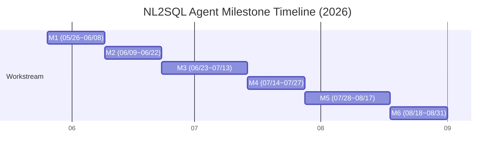

# NL2SQL Agent — Development Milestones

> **Target DB**: AWS Athena (Presto/Trino dialect)  
> **LLM**: OpenAI GPT-4o  
> **Created**: 2026-05-22  
> **Period**: 2026-05-26 ~ 2026-08-31 (14주)  
> **Owner**: Data Analytics Engineering Team

---

## Milestone Overview

| 월(상단 표시) | 05월 | 06월 | 07월 | 08월 |
|---|---|---|---|---|
| 일정 구간 | 05/26~05/31 | 06/01~06/30 | 07/01~07/31 | 08/01~08/31 |



| Milestone | Gate Date | Theme |
|-----------|-----------|-------|
| **Milestone 01** | 2026-05-26 | NL2SQL 기술 Survey & 평가 설계 |
| **Milestone 02** | 2026-06-09 | 데이터 분석 및 Schema Intelligence 설계 |
| **Milestone 03** | 2026-06-23 | NL2SQL 에이전트 코어 개발  |
| **Milestone 04** | 2026-07-14 | 평가 프레임워크 구축 및 성능 베이스라인 확보 |
| **Milestone 05** | 2026-07-28 | Edge 모델 교체 실험 및 Ablation Study |
| **Milestone 06** | 2026-08-18 | 개발 검증 설계 및 지속 평가 체계 구축 |

| Milestone | 제목 | 기간 | 일정 | 완료 기준 |
|-----------|------|------|------|-----------|
| **M1** | NL2SQL 기술 Survey & 평가 설계 | 2주 | 05/26 ~ 06/08 | Survey 보고서 + 벤치마크 설계 확정 |
| **M2** | 데이터 분석 및 Schema Intelligence 설계 | 2주 | 06/09 ~ 06/22 | 스키마 시맨틱 맵 + 아키텍처 확정 |
| **M3** | NL2SQL 에이전트 코어 개발 | 3주 | 06/23 ~ 07/13 | E2E 파이프라인 동작 확인 |
| **M4** | 평가 프레임워크 구축 및 성능 베이스라인 확보 | 2주 | 07/14 ~ 07/27 | EX ≥ 80% 달성 |
| **M5** | Edge 모델 교체 실험 및 Ablation Study | 3주 | 07/28 ~ 08/17 | 모델 교체 가능성 검증 완료 |
| **M6** | 개발 검증 설계 및 지속 평가 체계 구축 | 2주 | 08/18 ~ 08/31 | 배포 패키지 + 운영 지표 대시보드 |

---

## M1 · NL2SQL 기술 Survey & 평가 설계

> **기간**: 2주 (2026-05-26 ~ 2026-06-08)  
> **목표**: 도메인에 적합한 기술 스택 선정 근거 확보 및 평가 기준 사전 정의

### M1-1. 학술 동향 및 SOTA 분석

- [ ] Spider 2.0, BIRD, Dr. Spider 등 최신 벤치마크 결과표 분석
- [ ] Text-to-SQL 논문 트렌드 분류
  - **Prompt-based** (DAIL-SQL, DIN-SQL, C3-SQL)
  - **RAG-based** (CHESS, Schema Linking RAG)
  - **Fine-tuned** (SQLCoder, Defog 계열)
  - **Agent/ReAct** (SQL-ReAct, MAC-SQL)
- [ ] 한국어 NL2SQL 데이터 현황 조사 (KoNL2SQL, AI Hub 공개 데이터 여부)

### M1-2. AWS Athena 데이터 환경 분석

- [ ] Athena SQL 방언 특이점 정리 (Presto vs ANSI SQL 차이 매핑)
  - `DATE_TRUNC`, `APPROX_DISTINCT`, `ROW_NUMBER OVER` 등 Athena 전용 함수
  - 파티션 프루닝 필수 패턴 (`WHERE year=... AND month=...`)
  - `UNNEST`, `ARRAY_AGG` 등 복잡 데이터 타입 처리
- [ ] AWS Glue Data Catalog 메타데이터 구조 분석 (테이블/파티션/컬럼 통계 포함)
- [ ] 실제 데이터 레이크 쿼리 패턴 수집 (빈도 높은 쿼리 TOP 20 분류)

### M1-3. 평가 방법론 설계 *(데이터 분석 관점 핵심)*

- [ ] **쿼리 복잡도 분류 체계(Taxonomy)** 정의
  | 등급 | 유형 | 예시 |
  |------|------|------|
  | L1 | 단순 조회 (단일 테이블, 조건 1개) | "지난달 매출 조회" |
  | L2 | 집계·그룹핑 (GROUP BY, HAVING) | "부서별 평균 처리 건수" |
  | L3 | 다중 테이블 조인 (2~3개) | "고객별 주문 상품 목록" |
  | L4 | 서브쿼리·윈도우 함수 | "월별 누적 매출 랭킹" |
  | L5 | 중첩 쿼리·CTE·Athena 특화 | "파티션 기반 시계열 집계" |
- [ ] **평가 지표 정의**
  - **Execution Accuracy (EX)**: 실행 결과 집합 일치 여부 (Gold SQL 대비)
  - **Valid SQL Rate (VSR)**: 구문·실행 오류 없이 실행된 비율
  - **Schema Linking Accuracy**: 테이블·컬럼 매핑 정확도 (Precision/Recall)
  - **Self-Correction Rate (SCR)**: 1차 실패 후 재시도로 성공한 비율
  - **Semantic Equivalence Score**: 결과가 동일하나 SQL이 다른 경우 포용 (BLEU 보조)
- [ ] Gold 쿼리 어노테이션 가이드라인 작성 (레이블러 간 일치도 기준 Cohen's κ ≥ 0.8)

### M1-4. 기술 스택 선정

- [ ] Prompt Engineering 방식 vs RAG Schema Linking 방식 PoC 비교 (각 10개 질의 테스트)
- [ ] 벡터 스토어 옵션 비교: ChromaDB vs OpenSearch Serverless vs pgvector
- [ ] **의사결정 매트릭스** 작성 후 최종 스택 확정

### 산출물

| 파일 | 내용 |
|------|------|
| `docs/survey_report.md` | 기술 Survey 보고서 (SOTA 비교표 포함) |
| `docs/athena_dialect_guide.md` | Athena SQL 방언 레퍼런스 |
| `docs/evaluation_design.md` | 평가 방법론 및 지표 정의서 |
| `data/query_taxonomy.json` | 쿼리 복잡도 분류 체계 + 예시 |

---

## M2 · 데이터 분석 및 Schema Intelligence 설계

> **기간**: 2주 (2026-06-09 ~ 2026-06-22)  
> **목표**: 단순 스키마 추출을 넘어 **의미 있는 데이터 컨텍스트** 구축

### M2-1. 데이터 프로파일링 및 시맨틱 스키마 구축

- [ ] Glue Catalog 전체 테이블 메타데이터 추출 자동화 (boto3)
- [ ] **컬럼 시맨틱 레이어(Semantic Layer)** 구축
  - 컬럼 명칭 → 비즈니스 용어 매핑 사전 작성 (e.g., `cust_id` → "고객 식별자")
  - 컬럼 데이터 타입 + 샘플 값 + 통계 요약(min/max/null_rate) 포함
  - Enum 컬럼 도메인 값 자동 추출 (cardinality ≤ 50인 컬럼)
- [ ] 파티션 컬럼 식별 및 파티션 프루닝 규칙 자동 태깅

### M2-2. 테이블 관계 그래프 구성

- [ ] PK/FK 관계 자동 추론 (컬럼명 패턴 매칭 + LLM 보조)
- [ ] 테이블 조인 빈도 분석 (쿼리 로그 기반, Athena Query History 활용)
- [ ] **ERD 자동 생성** → 스키마 컨텍스트 삽입 시 활용

### M2-3. 에이전트 아키텍처 설계

```
┌──────────────────────────────────────────────────────────────────┐
│                        NL2SQL Agent                              │
│                                                                  │
│  ┌─────────────┐    ┌──────────────────┐    ┌────────────────┐  │
│  │ Query       │    │ Schema           │    │ Semantic       │  │
│  │ Understander│───►│ Linker           │◄───│ Layer Store    │  │
│  │ (GPT-4o)   │    │ (Embedding + LLM)│    │ (ChromaDB)     │  │
│  └──────┬──────┘    └────────┬─────────┘    └────────────────┘  │
│         │                   │                                   │
│         ▼                   ▼                                   │
│  ┌─────────────────────────────────────┐                        │
│  │          SQL Generator              │                        │
│  │  (GPT-4o + CoT Prompt + Few-shot)  │                        │
│  └──────────────┬──────────────────────┘                        │
│                 │                                               │
│         ┌───────▼────────┐                                      │
│         │ SQL Validator  │  ◄── sqlglot (Athena dialect)        │
│         └───────┬────────┘                                      │
│                 │ fail                                           │
│         ┌───────▼────────┐                                      │
│         │ Self-Corrector │  ◄── 오류 메시지 + 스키마 재조회      │
│         │ (ReAct Loop)   │      max 3회                         │
│         └───────┬────────┘                                      │
│                 │ success                                        │
│         ┌───────▼────────┐                                      │
│         │ Athena Executor│  ◄── boto3 + 비용 사전 추정          │
│         └───────┬────────┘                                      │
│                 │                                               │
│         ┌───────▼────────┐                                      │
│         │ Result Analyzer│  ◄── 결과 통계 요약 + 이상치 경고    │
│         └────────────────┘                                      │
└──────────────────────────────────────────────────────────────────┘
```

- [ ] 컴포넌트별 인터페이스(Input/Output 스키마) 정의
- [ ] **멀티턴 대화 컨텍스트** 관리 전략 결정 (슬라이딩 윈도우 vs 요약 압축)
- [ ] 오류 분류 체계 정의: `SCHEMA_ERROR` / `SYNTAX_ERROR` / `LOGIC_ERROR` / `PERMISSION_ERROR`
- [ ] API 명세 확정 (`POST /query`, `GET /schema`, `POST /feedback`)

### M2-4. 프롬프트 엔지니어링 전략 수립

- [ ] Chain-of-Thought (CoT) 프롬프트 구조 설계
  - Step 1: 질의 의도 분석 → Step 2: 관련 테이블 식별 → Step 3: SQL 초안 → Step 4: 검토·수정
- [ ] Few-shot 예시 선정 기준 수립 (난이도별 균형, 도메인 대표성)
- [ ] 시스템 프롬프트 템플릿 초안 작성

### 산출물

| 파일 | 내용 |
|------|------|
| `docs/architecture.md` | 에이전트 아키텍처 설계 문서 |
| `docs/semantic_layer_spec.md` | 시맨틱 레이어 구축 명세 |
| `docs/api_spec.md` | API 명세서 (OpenAPI 3.0) |
| `data/schema_semantic_map.json` | 테이블/컬럼 시맨틱 매핑 사전 |
| `prompts/system_prompt_v1.txt` | 시스템 프롬프트 초안 |

---

## M3 · NL2SQL 에이전트 코어 개발

> **기간**: 3주 (2026-06-23 ~ 2026-07-13)  
> **목표**: 설계 기반 E2E 동작 가능한 MVP 구현

### 프로젝트 구조

```
nl2sql_agent/
├── main.py
├── config.py
├── agent/
│   ├── nl2sql_agent.py       # 오케스트레이터 (ReAct 루프)
│   ├── query_understander.py # 질의 의도 분석 + 엔티티 추출
│   ├── schema_linker.py      # 스키마 링킹 (벡터 유사도 + LLM 재랭킹)
│   ├── sql_generator.py      # CoT 기반 SQL 생성 (GPT-4o)
│   ├── sql_validator.py      # sqlglot Athena dialect 검증
│   └── self_corrector.py     # 오류 유형별 수정 전략
├── schema/
│   ├── glue_extractor.py     # Glue Catalog 메타데이터 추출
│   ├── semantic_enricher.py  # 시맨틱 레이어 자동 보강
│   ├── vector_store.py       # ChromaDB 임베딩 인덱스
│   └── schema_retriever.py   # Top-K 유사 스키마 검색
├── athena/
│   ├── executor.py           # 비동기 폴링 + 비용 추정
│   ├── cost_guard.py         # 쿼리 비용 사전 추정 및 차단
│   └── result_analyzer.py    # 결과 통계 요약 + 이상치 탐지
├── prompts/
│   ├── system_prompt.txt
│   ├── cot_template.txt      # Chain-of-Thought 템플릿
│   ├── correction_prompt.txt
│   └── few_shot/
│       ├── l1_simple.json
│       ├── l2_aggregation.json
│       ├── l3_join.json
│       ├── l4_window.json
│       └── l5_athena_specific.json
├── evaluation/
│   ├── benchmark_runner.py   # 벤치마크 자동 실행
│   ├── metrics.py            # EX, VSR, SLA, SCR 계산
│   └── error_analyzer.py     # 오류 패턴 분류 및 집계
├── api/
│   ├── routes.py
│   └── schemas.py
└── tests/
    ├── unit/
    └── integration/
```

### M3-1. 인프라 및 스키마 파이프라인 (Week 1 / 06-23 ~ 06-29)

- [ ] 프로젝트 초기 구조 및 `requirements.txt` 설정
- [ ] `glue_extractor.py`: Glue Catalog 전체 메타데이터 추출 + 파티션 정보 포함
- [ ] `semantic_enricher.py`: 비즈니스 용어 사전 적용 + 컬럼 샘플 값 자동 수집
- [ ] `vector_store.py`: `text-embedding-3-large` 기반 ChromaDB 인덱싱
- [ ] `schema_retriever.py`: 질의 임베딩 기반 Top-K 테이블 검색 + LLM 재랭킹

### M3-2. SQL 생성 파이프라인 (Week 2 / 06-30 ~ 07-06)

- [ ] `query_understander.py`: GPT-4o로 질의 의도 분석, 핵심 엔티티·측정값·필터 추출
- [ ] `schema_linker.py`: 추출된 엔티티를 실제 테이블/컬럼으로 매핑 (Precision 우선)
- [ ] `sql_generator.py`: CoT 4단계 프롬프트 기반 SQL 생성 + 난이도별 Few-shot 주입
- [ ] `sql_validator.py`: sqlglot Athena dialect 파싱 → 오류 유형 분류 반환
- [ ] `self_corrector.py`: 오류 유형별 수정 전략 적용 (최대 3회, 회차별 전략 차별화)
- [ ] `few_shot/` L1~L5 전 등급 예시 작성 (등급별 최소 5개)

### M3-3. Athena 실행 및 결과 분석 (Week 2 / 06-30 ~ 07-06)

- [ ] `executor.py`: boto3 비동기 폴링 (SQS 방식 대신 polling with exponential backoff)
- [ ] `cost_guard.py`: `EXPLAIN` 또는 스캔 예상 크기로 비용 사전 추정, 임계값 초과 시 차단
- [ ] `result_analyzer.py`: 반환 결과 기술 통계 (행 수, null 비율, 이상치 경고) 자동 생성

### M3-4. API 서버 및 통합 (Week 3 / 07-07 ~ 07-13)

- [ ] `agent/nl2sql_agent.py`: 전체 ReAct 루프 오케스트레이션 구현
- [ ] `api/routes.py`: `/query`, `/schema/refresh`, `/feedback`, `/health` 구현
- [ ] 멀티턴 대화 컨텍스트 관리 구현 (세션별 대화 이력 슬라이딩 윈도우)
- [ ] 통합 로깅: 질의 → 생성 SQL → 실행 결과 → 소요 시간 전 구간 추적

### 완료 기준

- [ ] L1~L3 수준 질의 20개 수동 테스트 통과
- [ ] Athena 실 환경 연동 E2E 동작 확인
- [ ] API `/query` 엔드포인트 응답 정상 확인

---

## M4 · 평가 프레임워크 구축 및 성능 베이스라인 확보

> **기간**: 2주 (2026-07-14 ~ 2026-07-27)  
> **목표**: 재현 가능한 평가 체계 확립 및 목표 지표 달성

### M4-1. 도메인 특화 벤치마크 데이터셋 구축 *(핵심)*

- [ ] **NL-SQL 골드 쌍 100개** 작성 (복잡도 균형 배분)
  - L1: 20개 / L2: 25개 / L3: 25개 / L4: 20개 / L5: 10개
- [ ] **어노테이션 품질 관리**
  - 작성자 2인 독립 작성 후 교차 검토
  - Cohen's κ ≥ 0.8 달성 시 확정
  - 불일치 케이스 제3자 조정
- [ ] 훈련용(70) / 검증용(15) / 홀드아웃 테스트셋(15) 분리 (leakage 방지)
- [ ] 한국어 질의 + 영어 질의 + 혼용 질의 비율 균형 설정

### M4-2. 자동 평가 파이프라인 구축

- [ ] `benchmark_runner.py`: 데이터셋 자동 실행 + 결과 저장
- [ ] `metrics.py` 구현
  - **EX (Execution Accuracy)**: Gold SQL 실행 결과와 집합 비교 (순서 무관)
  - **VSR (Valid SQL Rate)**: 구문·실행 오류 없는 비율
  - **SLA (Schema Linking Accuracy)**: 테이블·컬럼 매핑 F1 Score
  - **SCR (Self-Correction Rate)**: 1차 실패 후 수정 성공률
  - **P95 Latency**: 에이전트 처리 시간 95th percentile
- [ ] `error_analyzer.py`: 실패 케이스 자동 분류 (`WRONG_TABLE` / `WRONG_COLUMN` / `WRONG_CONDITION` / `WRONG_AGGREGATION` / `SYNTAX`)

### M4-3. 성능 목표 달성을 위한 데이터 중심 개선

> 모델 변경보다 **데이터·프롬프트·스키마 품질** 개선을 우선

- [ ] **오류 패턴 분석**: error_analyzer 결과 기반 실패 케이스 클러스터링
- [ ] **취약 케이스 집중 개선**
  - 스키마 링킹 오류 → 시맨틱 레이어 보강 (비즈니스 용어 사전 확장)
  - 집계 오류 → L2/L4 Few-shot 예시 품질 개선 (CoT 강화)
  - Athena 방언 오류 → Athena 특화 규칙 프롬프트 추가
- [ ] **Schema Retrieval 최적화 실험**
  - Top-K 값 실험: K ∈ {3, 5, 7, 10}
  - 임베딩 모델: `text-embedding-3-small` vs `text-embedding-3-large`
  - 스키마 컨텍스트 포함 방식: 전체 DDL vs 요약 형식 vs 샘플 값 포함
- [ ] **프롬프트 Ablation 실험**
  - Baseline (Zero-shot) → + Few-shot → + CoT → + Schema Linking → + Self-Correction
  - 각 단계별 EX 변화량 측정 및 기록

### M4-4. 성능 목표 기준

| 지표 | 목표 | 비고 |
|------|------|------|
| EX (전체) | ≥ 80% | 홀드아웃 테스트셋 기준 |
| EX (L1~L3) | ≥ 90% | 실용 케이스 중심 |
| VSR | ≥ 95% | 구문 오류 최소화 |
| SLA (F1) | ≥ 85% | 스키마 링킹 정확도 |
| SCR | ≥ 70% | 자기 수정 성공률 |
| P95 Latency | ≤ 5초 | Athena 실행 시간 제외 |

### 산출물

| 파일 | 내용 |
|------|------|
| `data/benchmark/gold_dataset.json` | 골드 NL-SQL 쌍 100개 |
| `data/benchmark/annotation_guide.md` | 어노테이션 가이드라인 |
| `docs/performance_report_v1.md` | M4 성능 측정 보고서 |
| `docs/error_analysis.md` | 오류 패턴 분석 보고서 |
| `docs/ablation_study.md` | Ablation 실험 결과 |

---

## M5 · Edge 모델 교체 실험 및 Ablation Study

> **기간**: 3주 (2026-07-28 ~ 2026-08-17)  
> **목표**: GPT-4o 외 경량 모델로의 교체 가능성 검증 및 비용-성능 트레이드오프 분석

### M5-1. 모델 교체 인터페이스 추상화

- [ ] `config.py`에 `LLM_PROVIDER` 스위치 추가 (`openai` / `ollama` / `bedrock`)
- [ ] `sql_generator.py` provider 추상화 레이어 구현 (전략 패턴)
- [ ] AWS Bedrock 연동 추가 (Claude 3 Haiku, Nova Pro 후보)
- [ ] Ollama 로컬 서버 연동 구현 (오프라인 환경 대응)

### M5-2. 후보 모델 비교 실험

| 모델 | 유형 | 비고 |
|------|------|------|
| GPT-4o | Cloud | 기준 모델 (Baseline) |
| GPT-4o-mini | Cloud | 비용 절감 버전 |
| Claude 3.5 Haiku (Bedrock) | Cloud | AWS 네이티브 |
| SQLCoder-7B (Ollama) | Local | NL2SQL 특화 |
| Qwen2.5-Coder-7B (Ollama) | Local | 코드 생성 특화 |

- [ ] M4 홀드아웃 테스트셋으로 각 모델 EX / VSR / SCR 측정
- [ ] **비용-성능 트레이드오프 분석**: 쿼리당 비용 vs EX 산점도 작성
- [ ] 한국어 질의에서의 성능 차이 별도 분석

### M5-3. 모델별 프롬프트 최적화

- [ ] GPT-4o 최적 프롬프트 → 로컬 모델 전용 프롬프트 이식 가능성 검토
- [ ] 로컬 모델 전용 프롬프트 템플릿 작성 (더 명시적인 지시 필요)
- [ ] 모델별 Self-Correction 성능 차이 분석

### 산출물

| 파일 | 내용 |
|------|------|
| `docs/edge_model_report.md` | 모델 비교 실험 보고서 |
| `docs/cost_performance_tradeoff.md` | 비용-성능 분석 (산점도 포함) |
| `config/model_profiles.yaml` | 모델별 설정 프로파일 |

---

## M6 · 개발 검증 설계 및 지속 평가 체계 구축

> **기간**: 2주 (2026-08-18 ~ 2026-08-31)  
> **목표**: 실 서비스 배포 준비 및 운영 중 성능 모니터링 체계 확립

### M6-1. 데이터 품질 및 보안 강화

- [ ] **민감 컬럼 접근 제어**: 허용 테이블·컬럼 화이트리스트 정책 구현
- [ ] LLM 생성 SQL 샌드박싱: `SELECT` 전용 강제, DML/DDL 차단
- [ ] PII 컬럼(이메일, 전화번호 등) 자동 마스킹 규칙 적용
- [ ] AWS IAM 최소 권한 원칙 검토 (Athena ReadOnly + 지정 S3 버킷만)
- [ ] API 인증(JWT Bearer Token) 구현

### M6-2. 운영 모니터링 및 지속 평가 체계

- [ ] **실시간 성능 대시보드** 구성 (CloudWatch + Grafana 또는 QuickSight)
  - 일별 쿼리 수 / EX 추정치 / 오류율 / P95 지연시간
  - Athena 스캔 비용 누적 추이
- [ ] **데이터 드리프트 감지**: 스키마 변경(신규 테이블/컬럼) 자동 알림
- [ ] **사용자 피드백 루프 구현**
  - `/feedback` API로 좋아요/싫어요 수집
  - 부정 피드백 케이스 자동 벤치마크 추가 파이프라인
- [ ] 월별 벤치마크 재실행 스케줄러 (성능 회귀 방지)

### M6-3. E2E 통합 테스트 및 부하 테스트

- [ ] E2E 시나리오 테스트 (L1~L5 전 등급 커버)
- [ ] **엣지 케이스 테스트**
  - 스키마에 없는 테이블 질의 → graceful 오류 메시지 반환
  - 모호한 질의 → 명확화 질문(Clarification) 반환
  - 매우 큰 결과셋 질의 → LIMIT 자동 삽입 + 경고
  - 스키마 변경 직후 질의 → 캐시 무효화 후 재검색
- [ ] 동시 요청 부하 테스트: 10 / 30 / 50 RPS 단계별 측정
- [ ] Athena 쿼리 큐 과부하 시나리오 대응 확인

### M6-4. 배포 및 운영 환경 구성

- [ ] `Dockerfile` 및 `docker-compose.yml` 작성
- [ ] AWS ECS Fargate 배포 태스크 정의
- [ ] `Makefile`: `make build`, `make benchmark`, `make deploy` 타겟 정의
- [ ] 스키마 일일 갱신 스케줄러 (EventBridge + Lambda)
- [ ] CloudWatch 알람: 오류율 > 10%, P95 > 10초, Athena 비용 > 임계값

### M6-5. 문서화

- [ ] `README.md`: 빠른 시작 가이드
- [ ] `docs/ops_runbook.md`: 운영 런북 (장애 대응 절차 포함)
- [ ] `docs/schema_update_guide.md`: 스키마 추가·변경 시 운영 절차
- [ ] `docs/final_performance_report.md`: 최종 성능 지표 보고서

### 산출물

| 파일 | 내용 |
|------|------|
| `Dockerfile` | 컨테이너 이미지 정의 |
| `docker-compose.yml` | 로컬 개발 환경 |
| `docs/final_performance_report.md` | 최종 성능 보고서 |
| `docs/ops_runbook.md` | 운영 런북 |
| 배포 패키지 | ECS 태스크 정의 + 배포 스크립트 |

---

## 성능 목표 요약

| 지표 | M3 목표 (MVP) | M4 목표 | M6 목표 (운영) |
|------|--------------|---------|----------------|
| EX (전체) | ≥ 60% | ≥ 80% | ≥ 85% |
| EX (L1~L3) | ≥ 75% | ≥ 90% | ≥ 92% |
| VSR | ≥ 85% | ≥ 95% | ≥ 97% |
| SLA F1 | - | ≥ 85% | ≥ 88% |
| SCR | - | ≥ 70% | ≥ 75% |
| P95 Latency | ≤ 10초 | ≤ 5초 | ≤ 5초 |
| Athena 비용/쿼리 | - | 모니터링 | ≤ $0.05 |

---

## 기술 스택

| 영역 | 기술 |
|------|------|
| LLM | OpenAI GPT-4o (교체 가능: Claude via Bedrock, 로컬 Ollama) |
| Orchestration | 커스텀 ReAct Agent |
| Schema Store | ChromaDB + `text-embedding-3-large` |
| SQL Validation | sqlglot (Athena dialect) |
| Data Catalog | AWS Glue Data Catalog |
| Query Engine | AWS Athena (boto3) |
| API Server | FastAPI + Uvicorn |
| Evaluation | 커스텀 benchmark_runner + metrics.py |
| Monitoring | CloudWatch + 커스텀 대시보드 |
| Container | Docker + AWS ECS Fargate |
| Test | pytest |

---

## 리스크 및 대응 방안

| 리스크 | 가능성 | 영향도 | 대응 |
|--------|--------|--------|------|
| Athena 방언 불일치로 인한 쿼리 실패 | 높음 | 높음 | sqlglot Athena dialect + L5 전용 Few-shot 강화 |
| 스키마 변경 시 벡터 인덱스 outdated | 중간 | 높음 | 일일 스키마 갱신 스케줄러 + 변경 감지 알림 |
| GPT-4o 토큰 비용 초과 | 중간 | 중간 | 스키마 컨텍스트 압축 + 결과 캐싱 |
| 복잡 쿼리(L4/L5) 생성 실패율 높음 | 중간 | 중간 | 질의 분해 전략 + 단계별 SQL 조립 |
| 대용량 파티션 풀스캔으로 비용 폭증 | 낮음 | 높음 | cost_guard.py 사전 차단 + LIMIT 자동 삽입 |
| 한국어 질의 스키마 링킹 오류 | 중간 | 중간 | 비즈니스 용어 사전 한국어 확충 |
| PII 데이터 노출 | 낮음 | 매우 높음 | 컬럼 화이트리스트 + SELECT-only 강제 |
